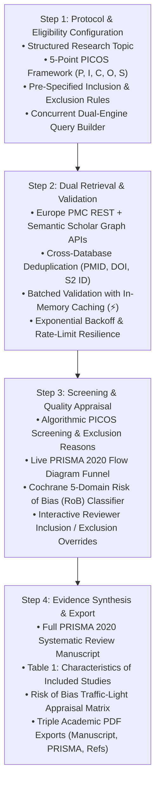

# 🔬 Sysrevai — AI-Assisted Systematic Review Platform (PRISMA 2020 Compliant)

[](LICENSE)
[](http://www.prisma-statement.org/)
[](https://europepmc.org)
[](https://www.nlm.nih.gov/bsd/uniform_requirements.html)
[](#-author--attribution)

> **From Clinical Research Question (PICOS) to Publication-Grade Systematic Review**  
> An automated, end-to-end evidence synthesis engine engineered for biomedical researchers, clinicians, and epidemiologists. Adheres strictly to **PRISMA 2020** guidelines, **Cochrane Risk of Bias (RoB 2 / ROBINS-I)** paradigms, and **ICMJE / Vancouver** bibliographic citation standards.

---

## 📑 Overview

While conventional AI literature tools produce brief narrative commentary papers, **Sysrevai** executes a full, methodologically sound **Systematic Review**:

1. **Structured PICOS Question Formulation**: Pre-specifies Population (P), Intervention (I), Comparator (C), Outcomes (O), and Study Design (S).
2. **Pre-Specified Inclusion & Exclusion Criteria Engine**: Algorithmic two-stage screening with explicit exclusion categorizations (e.g., animal/in-vitro model, editorial/narrative review, sample size < 20, missing comparator).
3. **Interactive PRISMA 2020 Flow Diagram**: Live calculation of Identification, Screening, Eligibility, and Included study counts with reason breakdowns and reviewer override controls.
4. **Cochrane Risk of Bias (RoB) Appraisal**: 5-domain evaluation of internal validity (Randomization, Allocation Concealment, Incomplete Data, Outcome Measurement, Selective Reporting) with a traffic-light matrix.
5. **Structured Characteristics of Included Studies**: Automated quantitative extraction of sample sizes, participant demographics, interventions, comparators, and primary effect estimates.
6. **Publication-Grade PRISMA 2020 Manuscript**: Complete IMRaD systematic review manuscript with 100% bibliographic parity, structured abstract, and multiple academic PDF exports.

---

## 📐 Pipeline Workflow



---

## ✨ Core Features

### 1. 🌐 Dual-Database Search & Cross-Database Deduplication
- **Concurrent Retrieval**: Queries both Europe PMC (MEDLINE, PMC) and the Semantic Scholar Academic Graph in parallel.
- **Pre-Configured S2 Credentials**: Embedded with dedicated Semantic Scholar API connectivity and customizable user key management.
- **Cross-Engine Deduplication**: Resolves duplicates via registered PubMed PMIDs, international DOIs, Semantic Scholar corpus IDs, and normalized alphanumeric title fingerprints.

### 2. ⚖️ Pre-Specified PICOS Eligibility & Screening Engine
- **PRISMA Item 5 Compliance**: Enforces explicit pre-specified inclusion and exclusion rules.
- **Automated Screening**: Classifies candidate records into `INCLUDED`, `EXCLUDED`, or `BORDERLINE / NEEDS FULL-TEXT AUDIT`.
- **Traceable Exclusion Rationales**: Systematically documents primary reasons for exclusion (e.g., pre-clinical model, non-original commentary, inadequate sample size, off-target comparator).
- **Human-in-the-Loop Overrides**: Reviewers can click to override any algorithmic decision, dynamically updating the PRISMA flow chart and synthesis pool in real time.

### 3. 📊 Interactive PRISMA 2020 Flow Architecture
- Real-time visualization of the 4 standard PRISMA phases:
  - **Identification**: Total records harvested across databases.
  - **Screening**: Title and abstract screening with duplicate removal.
  - **Eligibility**: Full-text appraisal and exclusions with breakdown.
  - **Included**: Final evidence synthesis cohort.

### 4. 🛡️ Methodological Quality & Risk of Bias (RoB) Matrix
- Implements Cochrane-aligned heuristic evaluations across 5 critical domains:
  - **D1**: Randomization process & selection bias
  - **D2**: Deviations from intended interventions & allocation concealment
  - **D3**: Missing outcome data & attrition bias
  - **D4**: Measurement of the outcome & detection bias
  - **D5**: Selection of the reported result & selective reporting
- Summarizes internal study validity into **Low Risk** (🟢), **Some Concerns** (🟡), or **High Risk** (🔴).

### 5. 📋 Table of Characteristics of Included Studies
- Extracts structured clinical parameters:
  - Study ID (`Author et al., Year`)
  - Epidemiological Study Design (`RCT`, `Cohort`, `Meta-Analysis`)
  - Extracted Sample Size ($N$)
  - Intervention & Comparator details
  - Reported Quantitative Effect Estimates & Primary Findings
  - Overall RoB rating

### 6. 📄 Triple Publication-Grade PDF Exports (jsPDF)
- **Complete Systematic Review Manuscript PDF**: Structured abstract, PICOS statement, PRISMA summary, full IMRaD text, and Vancouver bibliography.
- **PRISMA 2020 Flow & Risk of Bias Report PDF**: Dedicated audit report containing the PRISMA metrics and the full Cochrane RoB appraisal table.
- **Vancouver References PDF**: ICMJE-compliant reference listing linking directly to verified PMIDs and DOIs.

---

## 🚀 Quick Start

### Option A: Zero Install (Direct in Browser)
1. Clone or download this repository:
   ```bash
   git clone https://github.com/roroleaks/Sysrevai.git
   cd Sysrevai
   ```
2. Open `index.html` directly in Chrome, Edge, Firefox, or Safari.

### Option B: Local Node.js Server (Recommended for S2 Proxy)
1. Start the local server:
   ```bash
   node server.js
   # or: npm start
   ```
2. Navigate to:
   ```
   http://localhost:3000
   ```

---

## 📖 Citation Format (Vancouver Style)

Sysrevai formats citations in strict adherence to the **Uniform Requirements for Manuscripts Submitted to Biomedical Journals (ICMJE / Vancouver Style)**:

```text
1. Author AA, Author BB, Author CC, et al. Article Title. Journal Abbreviation. Year. doi:10.xxxx/xxxx. PMID: xxxxxxxx.
```

- In-text references are dynamically mapped in order of first appearance (`[1]`, `[2]`).
- Studies with more than 6 authors are truncated with `et al.` per NLM guidelines.

---

## 🛠️ Technology Stack

- **Frontend**: HTML5, Vanilla ES6+ JavaScript, CSS3 (Zero frameworks, zero bundlers).
- **Styling**: AIMed Biomedical Design System (`#0f6b6b`, responsive layout, PRISMA flow components).
- **PDF Generation**: [jsPDF 2.5.1](https://cdnjs.cloudflare.com/ajax/libs/jspdf/2.5.1/jspdf.umd.min.js) client-side vector engine.
- **APIs**:
  - [Europe PMC REST API](https://europepmc.org/RestfulWebService) (EMBL-EBI).
  - [Semantic Scholar Academic Graph API](https://api.semanticscholar.org/graph/v1) (Allen Institute for AI).

---

## 👨‍⚕️ Author & Attribution

**Dr. Raouf Roshdy**  
*Creator & Lead Architect, Sysrevai*  
Project: **AIMed Biomedical Informatics Initiative**  
*Dedicated to Prof. Dr. Abdel Hamid Attia*

---

## 📄 License

This project is licensed under the [MIT License](LICENSE) — free for educational, academic, and research use. Always verify AI-synthesized systematic reviews clinically and academically.
