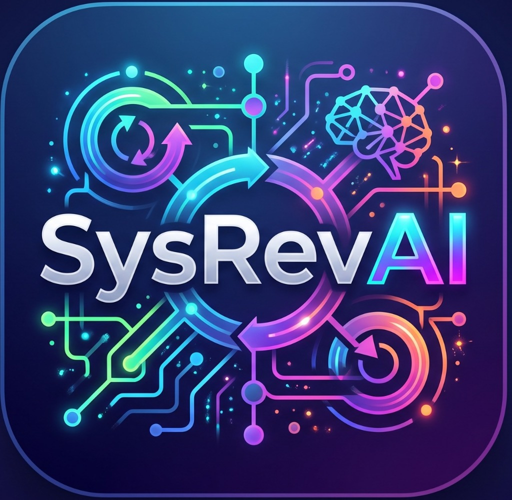
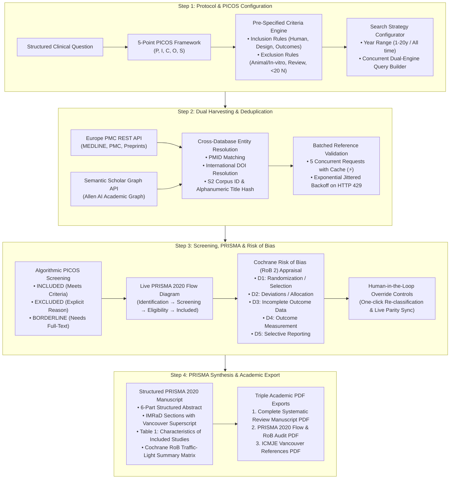

# 🔬 Sysrevai — AI-Assisted Systematic Review Platform

<div align="center">

<p align="center">
  
</p>

[](https://sysrevai.vercel.app)
[](https://github.com/roroleaks/Sysrevai)
[](LICENSE)

<br/>

[](http://www.prisma-statement.org/)
[](https://www.cochrane.org/)
[](https://europepmc.org)
[](https://www.nlm.nih.gov/bsd/uniform_requirements.html)
[](#-author--attribution)

<p align="center">
  <strong>From Clinical Research Question (PICOS) to Publication-Grade Systematic Review</strong><br/>
  <em>An automated, high-throughput evidence synthesis platform engineered for clinicians, medical researchers, and epidemiologists. Strictly adhering to PRISMA 2020 statements, Cochrane Risk of Bias heuristics, and ICMJE superscript citation standards.</em>
</p>

[**Explore Live App »**](https://sysrevai.vercel.app) · [**Report Issue »**](https://github.com/roroleaks/Sysrevai/issues) · [**Read PRISMA Guide »**](http://www.prisma-statement.org/)

</div>

---

## 💡 Why Sysrevai? The Next Evolutionary Leap

Most AI literature tools produce superficial narrative summaries or commentary reviews. **Sysrevai** bridges the chasm between raw conversational text generation and **methodologically rigorous, peer-review-grade Systematic Reviews**:

| Dimension | Standard AI Literature Summarizers | SciDraft AI (Predecessor) | 🔬 **Sysrevai (State of the Art)** |
| :--- | :--- | :--- | :--- |
| **Output Type** | Fragmented text summary | Narrative Commentary Review | **Full PRISMA 2020 Systematic Review** |
| **Clinical Question** | Free-form prompt | Research topic keyword | **Structured 5-Point PICOS Framework** |
| **Eligibility Criteria** | None (black-box retrieval) | Topic relevance scoring | **Pre-Specified Inclusion & Exclusion Rules** |
| **Screening Transparency** | Unverifiable | Unified paper cards | **Interactive PRISMA 2020 Funnel & Audit** |
| **Methodological Quality** | Omitted | Heuristic topic match | **5-Domain Cochrane Risk of Bias (RoB 2)** |
| **Data Extraction** | Vague paraphrasing | Primary abstract extracts | **Structured Table 1 of Included Studies** |
| **In-Text Citations** | Hallucinated / missing | Bracketed baseline `[1]` | **Superscript "Upper Case" Vancouver ($^{[1]}$)** |
| **Parity Guarantee** | Frequent mismatch | Automated parity audit | **100% In-Text to Bibliography Parity** |
| **Export Deliverables** | Plain text | Basic Draft + Refs PDF | **Triple Publication-Grade Academic PDFs** |

---

## 📐 End-to-End Pipeline Workflow



---

## ✨ Innovative Core Architecture

### 1. 🎯 Structured PICOS Question Formulation (PRISMA Item 5)
Sysrevai enforces structured clinical framing to eliminate retrieval ambiguity:
- **Population (P)**: Specific disease cohort, staging, and demographic criteria.
- **Intervention (I)**: Experimental pharmacologic, surgical, or technological therapy.
- **Comparator (C)**: Placebo, active comparator, or standard of care.
- **Outcomes (O)**: Quantifiable clinical endpoints (e.g. MACE, mortality, biomarkers).
- **Study Design (S)**: Strictly restricted to 9 empirical clinical study designs.

### 2. 🔬 Strict Restriction to 9 Empirical Study Types
Sysrevai searches and synthesizes **only 9 empirical research designs**, with the exact study type prominently identified and written on every paper card in search results, in the filter selector, across the manuscript narrative (Section 3.2 and 3.3), and in Table 1:
1. 🎲 **Randomized controlled trials (RCTs)**
2. ⚖️ **Non-randomized controlled trials**
3. 👥 **Cohort studies (prospective or retrospective)**
4. 🔍 **Case-control studies**
5. 📊 **Cross-sectional studies**
6. 🎯 **Diagnostic accuracy studies**
7. 📋 **Case series and case reports**
8. 💬 **Qualitative studies**
9. 🔬 **Observational studies**

*All non-empirical literature (narrative reviews, secondary systematic reviews, editorials, commentaries, opinion pieces, letters, and pre-clinical animal/in-vitro assays) are systematically excluded with transparent, auditable rationales.*

### 3. ⚖️ Pre-Specified Inclusion & Exclusion Screening Engine
Rather than relying on uninterpretable LLM judgements, Sysrevai executes a **two-tier algorithmic screening engine**:
- **Inclusion Rules**: Confirms human clinical population, comparative/interventional exposures, empirical findings, and validation as one of the 9 eligible study types.
- **Exclusion Rules**: Automatically filters:
  - 🚫 *Pre-clinical animal models, in-vitro experiments, or cell-line assays*
  - 🚫 *Narrative reviews, secondary systematic reviews, editorials, commentaries, or letters*
  - 🚫 *Non-empirical opinion pieces or conference abstracts without methodological data*
  - 🚫 *Duplicate cohort publications or redundant secondary data reports*
- **Traceable Rationales**: Every excluded record is permanently tagged with its exact reason for exclusion.
- **Investigator Overrides**: Reviewers can re-classify any paper with one click (`[✔ Include]` / `[✖ Exclude]`), dynamically updating the PRISMA diagram in real-time.

### 4. 📊 Publication-Quality PRISMA 2020 Flow Diagram Generator
Sysrevai features a standalone, interactive, publication-quality **PRISMA 2020 Flow Diagram Generator** adhering strictly to the official PRISMA 2020 Statement (*Page MJ et al., BMJ 2021;372:n71*):

- **4 Official PRISMA 2020 Templates Supported**:
  1. **Template A**: *New systematic review using databases and registers only* (Classic primary flow).
  2. **Template B**: *New systematic review using databases, registers, and other methods* (Dual parallel pathway: Websites, Organizations, Citation searching).
  3. **Template C**: *Updated systematic review using databases and registers only* (Incorporating previous study & report counts).
  4. **Template D**: *Updated systematic review using databases, registers, and other methods* (Complete multi-pathway architecture).

- **Strict Study vs. Report Distinction**:
  - Differentiates unique clinical investigations ($n\text{ studies}$) from multiple published articles or sub-analyses ($n\text{ reports}$).
  - Explicitly reports: *"New studies included in review ($n$)"* and *"Reports of new included studies ($n$)"*.

- **Real-Time Mathematical Validation Engine**:
  - Automatically verifies scientific accounting balance across all stages:
    $$\text{Screened} = \text{Total Identified} - \text{Removed before screening}$$
    $$\text{Reports Sought} = \text{Records Screened} - \text{Records Excluded}$$
    $$\text{Reports Assessed} = \text{Reports Sought} - \text{Reports Not Retrieved}$$
    $$\text{Reports Included} = \text{Reports Assessed} - \sum \text{Exclusion Reasons}$$
  - Reconciles multi-source evidence without double-counting.
  - Non-destructive validation: Flags mathematical discrepancies with actionable warnings rather than silently inventing or modifying scientific numbers.
  - Accommodates incomplete or in-progress reviews gracefully.

- **Interactive Diagram Editor Workspace**:
  - Click **“Open PRISMA 2020 Diagram Editor”** (or header shortcut) to launch the full-screen visual workbench.
  - Live preview with smooth interactive pan, zoom controls (50% to 200%), and "Fit to Screen".
  - Dynamic exclusion-reason manager: Add, edit, or remove categories (e.g. *Wrong population*, *Ineligible design*, *Insufficient data*) with automatic layout reflow.
  - Support for external systematic reviews: Enter study counts manually for reviews screened outside Sysrevai.
  - One-click **"Reset to Review Data"** button to restore live screening counts instantly.

- **High-Resolution Vector & Raster Exports**:
  - 🖼️ **High-Resolution PNG**: 300 DPI equivalent (3× canvas super-sampling) on a crisp white background, ready for journal figure submission.
  - 📐 **Pure Vector SVG**: Clean, standards-compliant, standalone vector SVG XML file.
  - 📋 **Copy SVG to Clipboard**: Instant paste into vector editors (Illustrator, Inkscape, Figma) or slide decks.
  - 📄 **Standalone PRISMA Diagram PDF**: Direct vector PDF export centered with official reference metadata.

### 5. 🛡️ Cochrane Risk of Bias (RoB 2 / ROBINS-I) Appraisal Matrix
Sysrevai assesses each included study against 5 critical methodological bias domains:
- **D1 (Randomization Process)**: Evaluates random sequence generation and baseline imbalances.
- **D2 (Deviations from Intended Interventions)**: Evaluates blinding and allocation concealment.
- **D3 (Missing Outcome Data)**: Evaluates participant attrition and dropouts.
- **D4 (Measurement of the Outcome)**: Evaluates blinded outcome assessors and objective scales.
- **D5 (Selection of Reported Results)**: Evaluates pre-registered protocols and selective reporting.
- Produces a visual **Traffic-Light Appraisal Matrix**: 🟢 **Low Risk**, 🟡 **Some Concerns**, or 🔴 **High Risk**.

### 6. 🔤 Upper Case / Superscript Vancouver Citations (ICMJE Standard)
In-text citations adhere to international biomedical journal standards (*The Lancet*, *JAMA*, *NEJM*):
- Dynamic mapping of references in exact order of appearance.
- Rendered in **upper case superscript numerals**:
  > *"Foundational multicenter trials have documented marked hazard ratio reductions across primary endpoints$^{[1,2]}$."*
- Features an instant toolbar switcher to toggle between:
  - `Upper Case Superscript [¹] ✓` *(Default)*
  - `Upper Case Superscript ¹ (No Brackets)`
  - `Baseline [1]`

### 7. 📋 Table of Characteristics of Included Studies (Table 1)
Automatically extracts and formats:
- **Study ID**: Primary author and publication year (`Author et al., 2024`)
- **Study Design**: Categorized into RCT, Prospective Cohort, Meta-Analysis, etc.
- **Sample Size ($N$)**: Extracted participant enrollment figures
- **Intervention & Comparator**: Clinical dosing and control regimens
- **Reported Quantitative Findings**: Hazard Ratios (HR), Relative Risks (RR), $p$-values, and primary effect estimates
- **Methodological RoB Score**: Overall quality appraisal

### 8. 📄 Triple Publication-Grade PDF Exports
Powered by client-side vector document generation ([jsPDF](https://cdnjs.com/libraries/jspdf)):
1. **Full Systematic Review Manuscript PDF**: Complete IMRaD manuscript with structured abstract, running headers, pagination, and references.
2. **PRISMA 2020 Flow & Risk of Bias Report PDF**: Dedicated audit report displaying the flow funnel and the full Cochrane RoB matrix.
3. **ICMJE Vancouver References PDF**: Clean bibliographic report with active PubMed and DOI resolution links.

---

## 🌐 Dual-Database Search Architecture

```
                               ┌────────────────────────────────────────┐
                               │   Sysrevai Literature Query Engine     │
                               └──────────────────┬─────────────────────┘
                                                  │
                         ┌────────────────────────┴────────────────────────┐
                         │                                                 │
                         ▼                                                 ▼
        ┌──────────────────────────────────┐             ┌──────────────────────────────────┐
        │        Europe PMC REST API       │             │   Semantic Scholar Graph API     │
        │      (EMBL-EBI / PubMed / PMC)   │             │   (Allen Institute for AI)       │
        └────────────────┬─────────────────┘             └─────────────────┬────────────────┘
                         │                                                 │
                         └────────────────────────┬────────────────────────┘
                                                  │
                                                  ▼
                               ┌─────────────────────────────────────┐
                               │   Cross-Database Entity Resolver    │
                               │   • Match registered PubMed PMIDs   │
                               │   • Match international DOIs        │
                               │   • Match Alphanumeric Title Hashes │
                               │   • Merge Citation Counts & URLs    │
                               └──────────────────┬──────────────────┘
                                                  │
                                                  ▼
                               ┌─────────────────────────────────────┐
                               │   Unified Deduplicated Review Pool  │
                               └─────────────────────────────────────┘
```

---

## 🚀 Quick Start & Installation

### Option 1: Direct Cloud Access (No Installation Needed)
Navigate directly to the live production deployment:  
👉 [**https://sysrevai.vercel.app**](https://sysrevai.vercel.app)

### Option 2: Zero Install (Local Browser)
1. Clone the repository:
   ```bash
   git clone https://github.com/roroleaks/Sysrevai.git
   cd Sysrevai
   ```
2. Double-click `index.html` to open directly in Google Chrome, Edge, Firefox, or Safari.

### Option 3: Local Node.js Server (Recommended for Full S2 Proxy)
1. Clone and start the lightweight local server:
   ```bash
   git clone https://github.com/roroleaks/Sysrevai.git
   cd Sysrevai
   node server.js
   ```
2. Open your browser and navigate to:
   ```
   http://localhost:3000
   ```

---

## 📋 PRISMA 2020 27-Item Compliance Matrix

Sysrevai is designed to satisfy the core reporting benchmarks of the **PRISMA 2020 Checklist**:

| PRISMA Section | Item # | Checklist Standard | Sysrevai Automated Implementation |
| :--- | :---: | :--- | :--- |
| **Title** | 1 | Identify report as a systematic review | Automated title generation: *"A Systematic Review and Evidence Synthesis Adhering to PRISMA 2020 Guidelines"* |
| **Abstract** | 2 | Structured summary of review | 6-part structured abstract: Background, Objectives, Methods, Results, Conclusions, Registration |
| **Rationale** | 3 | Describe rationale in context of knowledge | Section 1.1 formalizes the clinical dilemma and therapeutic equipoise |
| **Objectives** | 4 | Explicit PICOS question statement | Section 1.2 models full 5-point PICOS framework |
| **Eligibility** | 5 | Specify inclusion and exclusion criteria | Section 2.2 delineates pre-specified inclusion and exclusion rules |
| **Information Sources**| 6 | Specify all databases searched | Concurrent Europe PMC (MEDLINE, PMC) and Semantic Scholar API execution |
| **Search Strategy** | 7 | Present full electronic search query | Controlled MeSH and Boolean query formulation |
| **Selection Process** | 8 | Document screening and deduplication | Two-stage screening with tracked duplicate and exclusion counts |
| **Data Collection** | 9 | Process for obtaining study data | Automated parameter extraction (Sample size, Population, Finding) |
| **Risk of Bias** | 11, 14 | Methodological quality appraisal | 5-Domain Cochrane RoB 2 appraisal matrix with traffic-light indicators |
| **Synthesis of Results**| 13 | Summarize characteristics & findings | Section 3.3 individual study synthesis with 100% citation parity |
| **Citations** | Special | Complete bibliographic audit | Full ICMJE Vancouver format with superscript in-text numbering |

---

## 🛠️ Technology Stack

- **Core Engine**: HTML5, Vanilla Modern JavaScript (ES6+), Modern Responsive CSS3 (Zero frameworks, zero bloated dependencies).
- **Styling Architecture**: Custom AIMed Clinical Palette (`#0f6b6b`, `#0a4a4a`, `#e3f2f2`, `#15803d`, `#dc2626`).
- **Vector Document Engine**: [jsPDF 2.5.1](https://cdnjs.cloudflare.com/ajax/libs/jspdf/2.5.1/jspdf.umd.min.js) client-side vector engine.
- **External Literature APIs**:
  - [Europe PMC REST API](https://europepmc.org/RestfulWebService) (EMBL-EBI).
  - [Semantic Scholar Academic Graph API](https://api.semanticscholar.org/graph/v1) (Allen Institute for AI).
- **Deployment**: Vercel Cloud Serverless Edge Platform (`vercel.json`).

---

## 👨‍⚕️ Author & Attribution

**Dr. Raouf Roshdy**  
*Creator & Lead Architect, Sysrevai*  
Project: **AIMed Biomedical Informatics Initiative**  
*This application is dedicated to my mentor, Prof. Dr. Abdel Hamid Attia.*

---

## 📄 License & Academic Disclaimer

This project is licensed under the [MIT License](LICENSE) — free for educational, academic, clinical, and research use.

> [!IMPORTANT]  
> **Academic & Clinical Disclaimer**: Sysrevai is an AI-assisted biomedical informatics instrument designed to accelerate evidence synthesis. All synthesized systematic reviews, risk of bias assessments, and clinical conclusions must be verified by qualified medical professionals and peer reviewers prior to clinical guideline adoption or medical decision-making.
