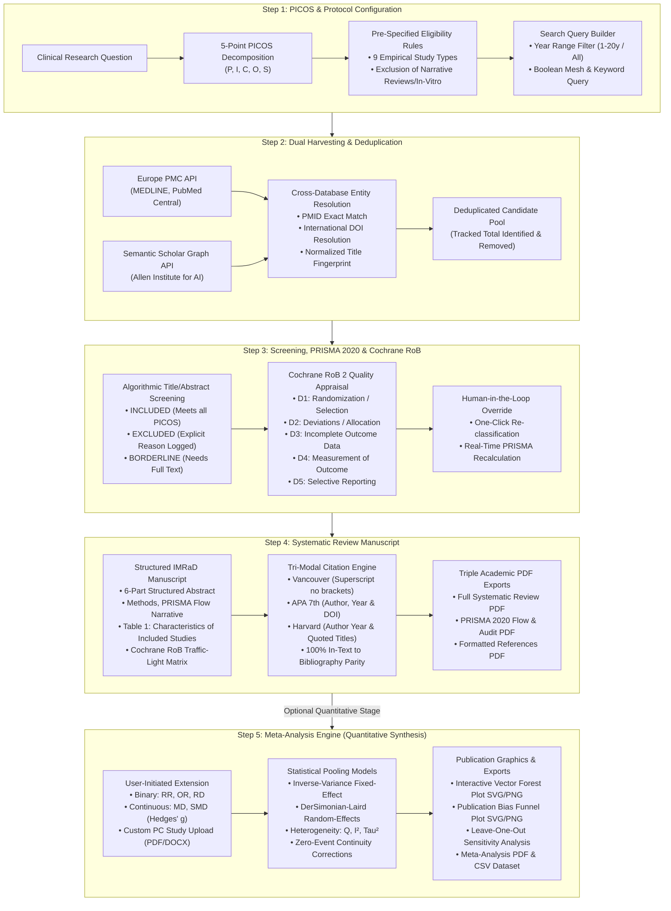
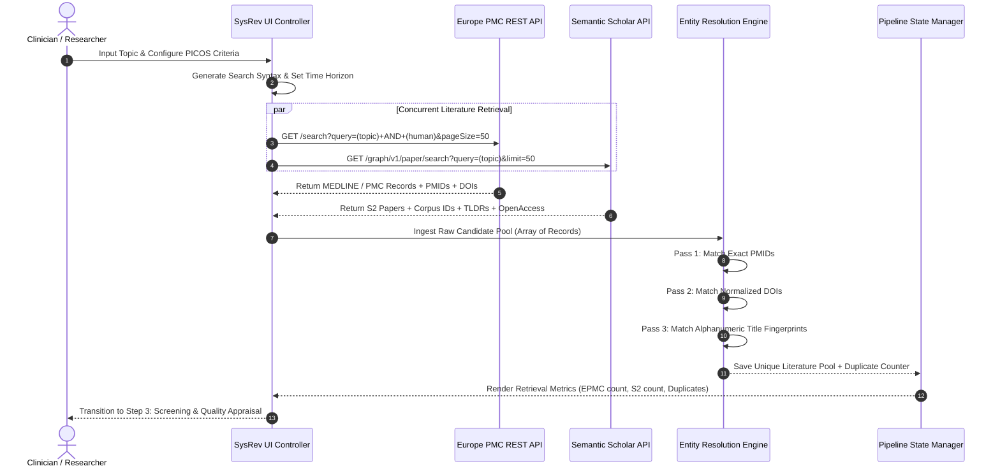
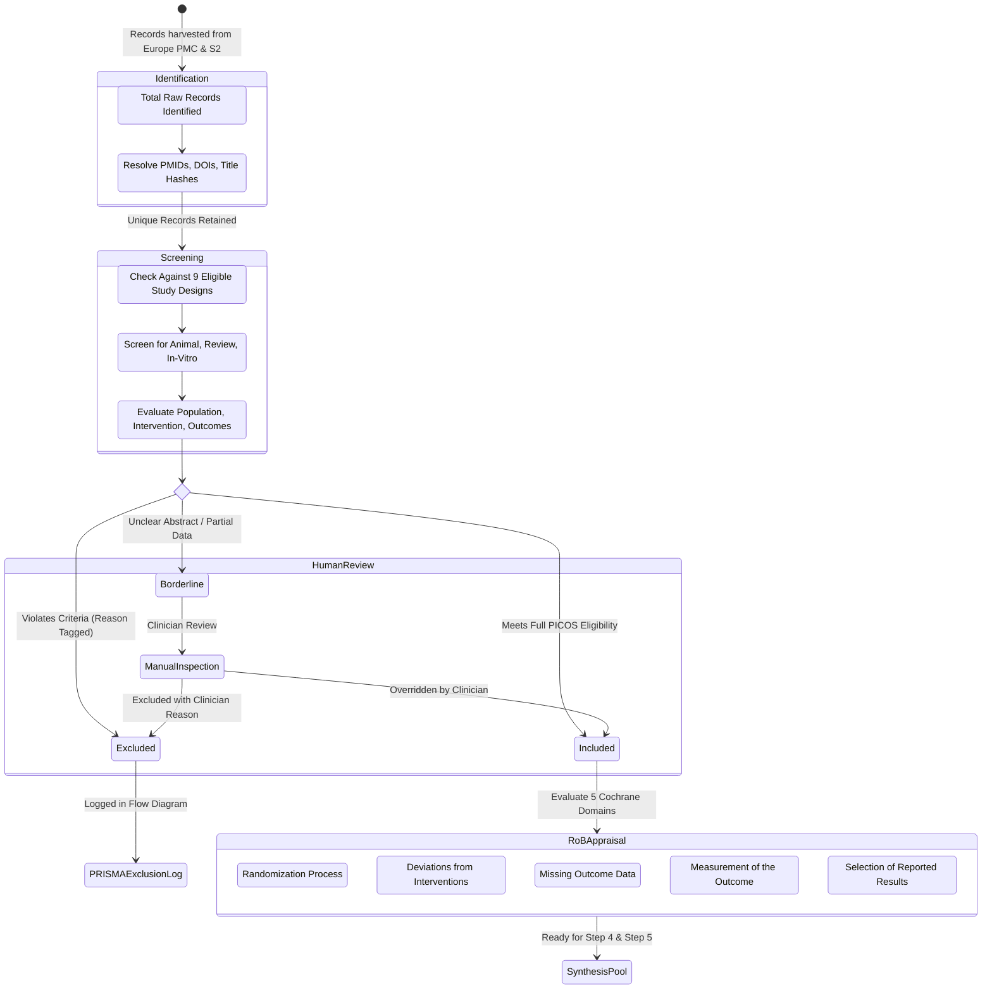
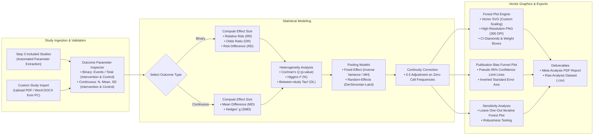

# 🔬 Sysrevai — AI-Assisted Systematic Review & Meta-Analysis Platform

<div align="center">

<p align="center">
  
</p>

[](https://sysrevai.vercel.app)
[](https://github.com/roroleaks/Sysrevai)
[](LICENSE)

<br/>

[](http://www.prisma-statement.org/)
[](https://www.cochrane.org/)
[](https://europepmc.org)
[](https://www.nlm.nih.gov/bsd/uniform_requirements.html)
[](#step-5-quantitative-synthesis--meta-analysis-engine)
[](#-author--attribution)

<p align="center">
  <strong>From Structured Clinical Question (PICOS) to Publication-Grade Systematic Review &amp; Meta-Analysis</strong><br/>
  <em>An automated, high-throughput evidence synthesis platform engineered for clinicians, medical researchers, and systematic review methodologists. Strictly compliant with PRISMA 2020 reporting standards, Cochrane Risk of Bias heuristics, tri-modal citation formatting (Vancouver, APA 7th, Harvard), and DerSimonian-Laird / Inverse-Variance quantitative meta-analysis pooling.</em>
</p>

[**🚀 Explore Live App**](https://sysrevai.vercel.app) • [**📋 PRISMA 2020 Statement**](http://www.prisma-statement.org/) • [**🐛 Report an Issue**](https://github.com/roroleaks/Sysrevai/issues)

</div>

---

## 📑 Table of Contents
1. [Why Sysrevai? Paradigm Shift in Evidence Synthesis](#-why-sysrevai-paradigm-shift-in-evidence-synthesis)
2. [End-to-End 5-Step Pipeline Architecture](#-end-to-end-5-step-pipeline-architecture)
3. [System Workflow Diagrams](#-system-workflow-diagrams)
   - [High-Level 5-Step Pipeline Flow](#1-high-level-5-step-pipeline-flow)
   - [Dual Harvesting & Cross-Database Deduplication Sequence](#2-dual-harvesting--cross-database-deduplication-sequence)
   - [PRISMA 2020 Screening & Decision State Machine](#3-prisma-2020-screening--decision-state-machine)
   - [Quantitative Meta-Analysis Pooling & Forest Plot Engine](#4-quantitative-meta-analysis-pooling--forest-plot-engine)
4. [Deep Dive into Pipeline Stages](#-deep-dive-into-pipeline-stages)
   - [Step 1: PICOS & Eligibility Criteria Configuration](#step-1-picos--eligibility-criteria-configuration)
   - [Step 2: Dual Retrieval & Entity Resolution](#step-2-dual-retrieval--entity-resolution)
   - [Step 3: PRISMA Screening & Cochrane RoB 2](#step-3-prisma-screening--cochrane-rob-2)
   - [Step 4: Systematic Review Manuscript Synthesis](#step-4-systematic-review-manuscript-synthesis)
   - [Step 5: Quantitative Synthesis & Meta-Analysis Engine](#step-5-quantitative-synthesis--meta-analysis-engine)
5. [Triple Citation Engine & Parity Guarantee](#-triple-citation-engine--parity-guarantee)
6. [Interactive PRISMA 2020 Flow Diagram Generator](#-interactive-prisma-2020-flow-diagram-generator)
7. [Medical & Scientific AI Advisory Compliance](#-medical--scientific-ai-advisory-compliance)
8. [PRISMA 2020 27-Item Compliance Matrix](#-prisma-2020-27-item-compliance-matrix)
9. [Quick Start & Installation](#-quick-start--installation)
10. [Technology Stack](#-technology-stack)
11. [Author & Attribution](#-author--attribution)
12. [License & Disclaimer](#-license--disclaimer)

---

## 💡 Why Sysrevai? Paradigm Shift in Evidence Synthesis

Traditional conversational AI tools output unstructured narrative summaries or opinion commentaries that violate evidence-based medicine standards. They hallucinate citations, fail to document identification counts, ignore pre-specified criteria, and cannot synthesize statistical effect sizes.

**Sysrevai** introduces a deterministic, reproducible, transparent pipeline designed specifically for systematic review methodology:

| Methodology Dimension | Standard AI Literature Bots | Narrative AI Summarizers | 🔬 **Sysrevai Platform** |
| :--- | :--- | :--- | :--- |
| **Protocol Framework** | Unstructured prompt | Free-form summary | **Structured 5-Point PICOS Protocol** |
| **Eligible Study Types** | Unfiltered / mixed | Variable | **Strict Restriction to 9 Empirical Designs** |
| **Search Infrastructure** | Single API / black box | Web search scraping | **Europe PMC + Semantic Scholar Dual APIs** |
| **Entity Resolution** | Incomplete / duplicates | None | **PMID, DOI, and Title-Hash Deduplication** |
| **Screening Transparency** | Unverifiable | Opaque | **PRISMA 2020 Interactive Funnel with Rationale** |
| **Quality Assessment** | Omitted | Subjective ranking | **5-Domain Cochrane RoB 2 Traffic-Light Matrix** |
| **Data Extraction** | Vague text snippets | Manual copying | **Automated Characteristics Table (Table 1)** |
| **Citation Formatting** | Bracketed numbers `[1]` | Static links | **Vancouver (Superscript), APA 7th, Harvard** |
| **Citation Parity** | Frequent discrepancies | Loose parity | **Deterministic 100% Text-to-Bibliography Audit** |
| **Quantitative Pooling** | Unsupported | Unsupported | **Meta-Analysis: Binary (RR/OR/RD) & Continuous (MD/SMD)** |
| **Forest & Funnel Plots** | Unsupported | Unsupported | **Vector SVG + High-Res PNG + Leave-One-Out Plots** |
| **Academic Exports** | Raw text / Markdown | Basic document | **Triple Publication PDFs + CSV Dataset + SVG Diagrams** |

---

## 🗺️ End-to-End 5-Step Pipeline Architecture

The platform is organized into five tightly coupled, transparent stages:

```
[ Step 1: PICOS & Eligibility ] ➔ [ Step 2: Dual Retrieval ] ➔ [ Step 3: PRISMA Screening & RoB ] ➔ [ Step 4: Manuscript Synthesis ] ➔ [ Step 5: Meta-Analysis ]
```

1. **Step 1 · PICOS & Eligibility Criteria**: Define clinical question, decompose into structured PICOS (Population, Intervention, Comparator, Outcomes, Study Design), set pre-specified inclusion/exclusion rules, and construct boolean search queries.
2. **Step 2 · Dual Retrieval & Validation**: Harvest records concurrently from Europe PMC (MEDLINE, PMC) and Semantic Scholar Academic Graph with cross-database entity resolution, deduplication, and rate-limit backoff.
3. **Step 3 · PRISMA Screening & RoB**: Screen literature against protocol rules, classify into Included / Excluded / Borderline with explicit reasons, evaluate 5 Cochrane RoB domains, and generate dynamic PRISMA 2020 flow diagrams.
4. **Step 4 · Systematic Review Manuscript**: Synthesize an IMRaD systematic review manuscript adhering to PRISMA 2020, generate Table 1 of study characteristics, support instant switching between Vancouver, APA 7th, and Harvard citations, and export publication PDFs.
5. **Step 5 · Meta-Analysis (Quantitative Synthesis)**: User-initiated statistical pooling for binary (Relative Risk, Odds Ratio, Risk Difference) and continuous outcomes (Mean Difference, Hedges' g Standardized Mean Difference), heterogeneity profiling ($I^2$, $\tau^2$, Cochran's $Q$), custom PDF/DOCX paper ingestion, Forest Plots, Funnel Plots, and Leave-One-Out sensitivity analysis.

---

## 📊 System Workflow Diagrams

### 1. High-Level 5-Step Pipeline Flow



---

### 2. Dual Harvesting & Cross-Database Deduplication Sequence



---

### 3. PRISMA 2020 Screening & Decision State Machine



---

### 4. Quantitative Meta-Analysis Pooling & Forest Plot Engine



---

## 🔬 Deep Dive into Pipeline Stages

### Step 1: PICOS & Eligibility Criteria Configuration
* **Topic & Protocol Definition**: Input clinical inquiry (e.g. *"Efficacy and Safety of GLP-1 Receptor Agonists on Cardiovascular Outcomes in Patients with Type 2 Diabetes"*).
* **Decomposed 5-Point PICOS Framework**:
  - **P (Population)**: Cohort characteristics, age, disease severity, baseline comorbidities.
  - **I (Intervention)**: Specific drug dosage, surgical procedure, medical device, or diagnostic intervention.
  - **C (Comparator)**: Placebo, standard of care, active comparator, or sham procedure.
  - **O (Outcomes)**: Primary efficacy endpoints, secondary outcomes, composite safety outcomes, mortality.
  - **S (Study Design)**: Strictly targeted to empirical designs.
* **Pre-Specified Inclusion & Exclusion Rules**: Customizable rule engine guaranteeing transparent screening.
* **Strict Restriction to 9 Eligible Study Types**:
  1. *Randomized controlled trials (RCTs)*
  2. *Non-randomized controlled trials*
  3. *Cohort studies (prospective or retrospective)*
  4. *Case-control studies*
  5. *Cross-sectional studies*
  6. *Diagnostic accuracy studies*
  7. *Case series and case reports*
  8. *Qualitative studies*
  9. *Observational studies*
  *(All non-empirical articles, narrative reviews, secondary meta-analyses, commentaries, and letters are systematically excluded).*

### Step 2: Dual Retrieval & Entity Resolution
* **Europe PMC Integration**: Harvests peer-reviewed biomedical literature across PubMed, PubMed Central, and open preprints via REST API.
* **Semantic Scholar Graph Integration**: Ingests citation metadata, TLDR summaries, corpus IDs, and influence metrics from the Allen Institute for AI.
* **Multi-Stage Entity Resolution**:
  - **PMID Matching**: Deduplicates records sharing identical PubMed identifiers.
  - **DOI Resolution**: Canonicalizes international DOIs to eliminate cross-publisher duplications.
  - **Title-Hash Fingerprinting**: Employs alphanumeric normalization (lowercased, stripped punctuation) to catch duplicate records lacking DOIs.
* **Resilient Infrastructure**: Automatic backoff with jitter on HTTP 429 rate limits, partial failover, and local caching.

### Step 3: PRISMA Screening & Cochrane RoB 2
* **Automated PICOS Screening Engine**: Evaluates title, abstract, keywords, and study design to classify each paper as **Included**, **Excluded** (with specific rationale), or **Borderline**.
* **5-Domain Cochrane Risk of Bias (RoB 2) Matrix**:
  - *Domain 1: Bias arising from the randomization process*
  - *Domain 2: Bias due to deviations from intended interventions*
  - *Domain 3: Bias due to missing outcome data*
  - *Domain 4: Bias in measurement of the outcome*
  - *Domain 5: Bias in selection of the reported result*
  - *Overall Risk*: Automated traffic-light classification (**Low Risk** 🟢, **Some Concerns** 🟡, **High Risk** 🔴).
* **Human-in-the-Loop Supervision**: Clinicians can re-classify any paper with a single click, instantly updating PRISMA counts and manuscript synthesis.

### Step 4: Systematic Review Manuscript Synthesis
* **PRISMA 2020 Compliant Structure**:
  - **Structured Abstract**: Background, Objectives, Methods, Results, Conclusions, Registration.
  - **Introduction**: Clinical dilemma, therapeutic equipoise, explicit PICOS objective statement.
  - **Methods**: Search strategy, database sources, eligibility criteria, screening protocol, RoB appraisal.
  - **Results**: Study selection, PRISMA flow narrative, RoB summary, characteristics of included studies (**Table 1**), individual synthesis by outcome.
  - **Discussion**: Primary findings, comparison with existing literature, strengths, limitations, clinical implications.
  - **Conclusions & Guidance**: Actionable clinical takeaways and future research priorities.
* **Table 1: Characteristics of Included Studies**: Structured comparison of author, year, study type, sample size, population, intervention, comparator, and primary findings.
* **Triple PDF Document Generation**:
  1. *Complete Systematic Review Manuscript PDF*
  2. *PRISMA 2020 Flow Diagram & Risk of Bias Audit PDF*
  3. *Comprehensive References Bibliography PDF*

### Step 5: Quantitative Synthesis & Meta-Analysis Engine
Sysrevai includes a dedicated statistical meta-analysis module (Step 5) that enables quantitative pooling without third-party statistical software (such as R `meta`, RevMan, or Stata):
* **Binary Effect Measures**:
  - **Risk Ratio (RR)**
  - **Odds Ratio (OR)**
  - **Risk Difference (RD)**
* **Continuous Effect Measures**:
  - **Mean Difference (MD)**
  - **Standardized Mean Difference (SMD / Hedges' g)** with small-sample bias adjustment ($J \approx 1 - \frac{3}{4df - 1}$).
* **Statistical Pooling Models**:
  - **Fixed-Effect Model**: Inverse-variance and Mantel-Haenszel weighting.
  - **Random-Effects Model**: DerSimonian-Laird estimator for between-study variance ($\tau^2$).
* **Comprehensive Heterogeneity Assessment**:
  - **Cochran's $Q$ Test**: Chi-square distributed test statistic with degrees of freedom and $p$-value.
  - **Higgins & Thompson's $I^2$**: Quantifies proportion of total variation attributable to heterogeneity ($I^2 = \max(0, \frac{Q - df}{Q}) \times 100\%$).
  - **$\tau^2$ (Tau-squared)**: Estimate of between-study variance.
* **Zero-Event Handling**: Automated $0.5$ continuity correction for studies with zero cells in binary $2 \times 2$ tables, with transparent clinical warnings.
* **Import Custom Studies from PC**: Clinicians can import trial publications directly from their PC in **PDF**, **Word DOC/DOCX**, or **TXT** formats. The system parses and ingests title, sample size, and effect numbers directly into the meta-analysis pool.
* **Publication Graphics Suite**:
  - **Forest Plot Generator**: Vector SVG and 300 DPI PNG with study weights, 95% confidence intervals, and pooled summary diamonds.
  - **Funnel Plot**: Evaluates small-study effects and publication bias with pseudo 95% confidence limit funnels.
  - **Leave-One-Out Sensitivity Analysis**: Re-pools the meta-analysis excluding each study sequentially to identify disproportionate influence.
  - **CSV & PDF Export**: One-click download of the pooled dataset and complete quantitative report.

---

## 📚 Triple Citation Engine & Parity Guarantee

Sysrevai provides a one-click citation switcher on the manuscript page supporting three internationally recognized academic referencing systems:

```
[ Vancouver ]   [ APA ]   [ Harvard ]
```

### 1. Vancouver Style (ICMJE Standard)
* **In-Text Citation**: Uppercase superscript numbers without brackets:
  $$\text{Recent landmark trials}^{1, 2}\text{ demonstrated significant reduction}^{3}.$$
* **Bibliography**: Numbered sequentially in order of appearance following National Library of Medicine (NLM) / ICMJE standards:
  > 1. Marso SP, Daniels GH, Brown-Frandsen K, et al. Liraglutide and Cardiovascular Outcomes in Type 2 Diabetes. *N Engl J Med*. 2016;375(4):311-322. doi:10.1056/NEJMoa1603827

### 2. APA 7th Edition
* **In-Text Citation**: Author-year format with ampersand `&` and comma:
  $$\text{Recent landmark trials (Marso \& Daniels, 2016; Wilding \& Batterham, 2021) demonstrated significant reduction.}$$
* **Bibliography**: Alphabetized by first author surname with sentence-case titles and HTTPS DOIs:
  > Marso, S. P., Daniels, G. H., & Brown-Frandsen, K. (2016). Liraglutide and cardiovascular outcomes in type 2 diabetes. *New England Journal of Medicine*, 375(4), 311–322. https://doi.org/10.1056/NEJMoa1603827

### 3. Harvard Style
* **In-Text Citation**: Author-year format without comma and with spelled-out `and`:
  $$\text{Recent landmark trials (Marso and Daniels 2016; Wilding and Batterham 2021) demonstrated significant reduction.}$$
* **Bibliography**: Alphabetized by first author surname with single-quoted titles and explicit volume/issue/page abbreviations:
  > Marso, S.P., Daniels, G.H. and Brown-Frandsen, K., 2016. 'Liraglutide and cardiovascular outcomes in type 2 diabetes', *New England Journal of Medicine*, vol. 375, no. 4, pp. 311–322. Available at: <https://doi.org/10.1056/NEJMoa1603827> [Accessed 22 October 2026].

### 🔒 100% Citation Parity Guarantee
An integrated deterministic audit verifies:
1. Every cited study in the narrative corresponds to an exact bibliographic entry.
2. Every entry in the reference list is cited in the text (zero orphan citations).
3. Citation indices and author spellings match with zero discrepancy.

---

## 📐 Interactive PRISMA 2020 Flow Diagram Generator

Sysrevai includes a vector flow diagram generator adhering to the official **PRISMA 2020 statement** with four supported layout templates:

| Template | Scope | Architectural Description |
| :---: | :--- | :--- |
| **Template A** | *Standard Review* | Flow for new systematic reviews searching databases and registers only. |
| **Template B** | *Extended Multi-Source* | Flow for reviews searching databases, registers, and other search methods (websites, organizations, citations). |
| **Template C** | *Review Update* | Flow for updated systematic reviews tracking previous review records alongside new search records. |
| **Template D** | *Comprehensive Update* | Flow for updated reviews incorporating both new databases and non-database identification sources. |

*All flow diagrams dynamically update in real time as studies are screened or re-classified, and can be downloaded as vector SVG or exported inside the PRISMA Audit PDF.*

---

## ⚖️ Medical & Scientific AI Advisory Compliance

Sysrevai implements strict biomedical AI governance and transparency safeguards:
* **Evidence Synthesis Auxiliary Engine**: Explicitly designed as a PRISMA 2020 protocol engine to support human researchers, not replace clinical decision-making.
* **Probabilistic Awareness**: Highlights that generative models are probabilistic and mandate independent clinician oversight.
* **Supervision Requirement**: All eligibility decisions, Cochrane RoB 2 appraisals, and statistical syntheses must be independently supervised by qualified investigators before clinical adoption.
* **On-Demand Advisory**: Users can review the complete medical AI advisory at any time via the persistent `⚖️ AI Advisory` footer trigger.

---

## 📋 PRISMA 2020 27-Item Compliance Matrix

| PRISMA Section | Item # | Checklist Standard | Sysrevai Implementation |
| :--- | :---: | :--- | :--- |
| **Title** | 1 | Identify report as a systematic review | Automatic title: *"A Systematic Review and Evidence Synthesis Adhering to PRISMA 2020 Guidelines"* |
| **Abstract** | 2 | Structured summary of review | 6-part structured abstract: Background, Objectives, Methods, Results, Conclusions, Registration |
| **Rationale** | 3 | Describe rationale in context of knowledge | Section 1.1 formalizes clinical background and therapeutic equipoise |
| **Objectives** | 4 | Explicit PICOS statement | Section 1.2 models complete 5-point PICOS framework |
| **Eligibility** | 5 | Specify inclusion and exclusion criteria | Section 2.2 formalizes pre-specified inclusion and exclusion rules |
| **Information Sources**| 6 | Specify all databases searched | Concurrent Europe PMC and Semantic Scholar API execution |
| **Search Strategy** | 7 | Present full electronic search query | Controlled MeSH and Boolean query construction |
| **Selection Process** | 8 | Document screening and deduplication | Two-stage screening with tracked duplicate and exclusion tallies |
| **Data Collection** | 9 | Process for obtaining study data | Automated parameter extraction (Sample size, Population, Findings) |
| **Risk of Bias** | 11, 14 | Methodological quality appraisal | 5-Domain Cochrane RoB 2 appraisal matrix with traffic-light indicators |
| **Synthesis of Results**| 13 | Summarize characteristics & findings | Section 3.3 individual study synthesis with 100% citation parity |
| **Meta-Analysis** | 13, 15 | Quantitative effect pooling & heterogeneity | Step 5: RR/OR/RD/MD/SMD pooling, $I^2$, $\tau^2$, Cochran's $Q$, Forest Plots |
| **Citations** | Specific | Complete bibliographic audit | Tri-modal citation engine (Vancouver, APA 7th, Harvard) with parity audit |

---

## 🚀 Quick Start & Installation

### Option 1: Direct Cloud Access (Zero Installation)
Launch the production web application directly in your browser:  
👉 [**https://sysrevai.vercel.app**](https://sysrevai.vercel.app)

### Option 2: Zero-Dependency Local Browser Run
1. Clone the repository:
   ```bash
   git clone https://github.com/roroleaks/Sysrevai.git
   cd Sysrevai
   ```
2. Double-click `index.html` to open directly in Google Chrome, Microsoft Edge, Mozilla Firefox, or Apple Safari.

### Option 3: Local Node.js Development Server
1. Clone the repository and start the server:
   ```bash
   git clone https://github.com/roroleaks/Sysrevai.git
   cd Sysrevai
   node server.js
   ```
2. Open your browser and navigate to:
   ```
   http://localhost:3000
   ```

---

## 🛠️ Technology Stack

* **Frontend Architecture**: Pure Vanilla Modern JavaScript (ES6+), HTML5, Responsive CSS3 (Zero bloated frontend frameworks, instantaneous rendering).
* **Statistical Meta-Analysis Engine**: Client-side mathematical implementation of DerSimonian-Laird, Inverse-Variance, Hedges' $g$, and Cochran's $Q$ (`meta-analysis-engine.js`).
* **PRISMA 2020 Vector Engine**: Scalable Vector Graphics (SVG) template renderer (`prisma-generator.js`).
* **PDF Document Generator**: [jsPDF 2.5.1](https://cdnjs.cloudflare.com/ajax/libs/jspdf/2.5.1/jspdf.umd.min.js) client-side vector engine.
* **Document Parsers**: [PDF.js 3.11](https://cdnjs.cloudflare.com/ajax/libs/pdf.js/3.11.174/pdf.min.js) and [Mammoth.js 1.6](https://cdnjs.cloudflare.com/ajax/libs/mammoth/1.6.0/mammoth.browser.min.js) for parsing user-uploaded trial publications.
* **Literature APIs**:
  * [Europe PMC REST Web Service](https://europepmc.org/RestfulWebService) (EMBL-EBI).
  * [Semantic Scholar Academic Graph API](https://api.semanticscholar.org/graph/v1) (Allen Institute for AI).
* **Hosting & Deployment**: Vercel Cloud Serverless Edge Platform (`vercel.json`).

---

## 👨‍⚕️ Author & Attribution

**Dr. Raouf Roshdy**  
*Creator & Lead Architect, Sysrevai*  
Project: **AIMed Biomedical Informatics Initiative**  
*Dedicated to my mentor, Prof. Dr. Abdel Hamid Attia.*

---

## 📜 License & Disclaimer

This project is licensed under the [MIT License](LICENSE) — free for educational, clinical, and scientific research use.

> [!IMPORTANT]
> **Academic & Clinical Disclaimer**: Sysrevai is an auxiliary research synthesis and PRISMA 2020 protocol platform designed to accelerate evidence synthesis. All synthesized systematic reviews, risk of bias assessments, and statistical meta-analyses must be supervised and verified by qualified human medical researchers and clinicians prior to clinical guideline adoption or medical practice decisions.
